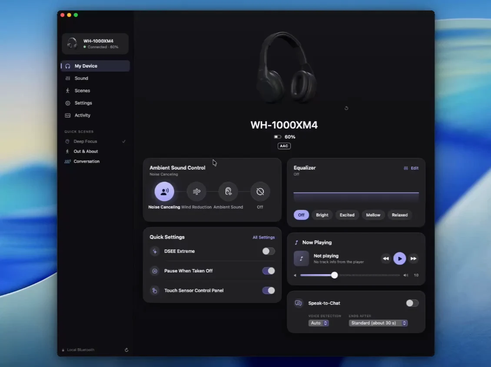
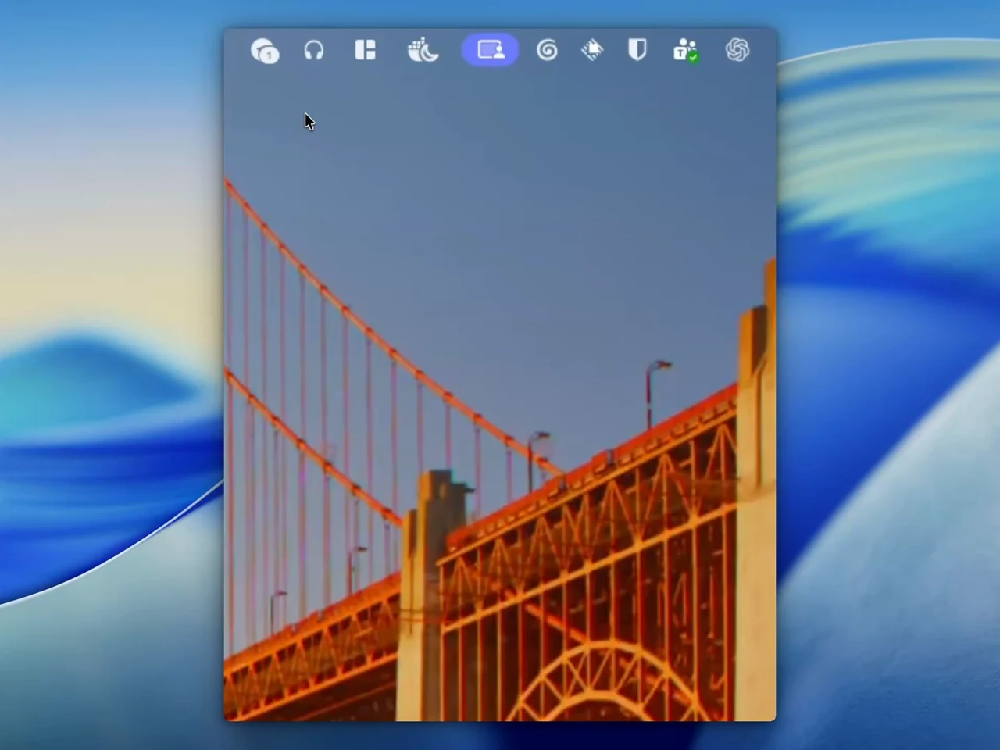

# Open Sound Connect

Support the app at [opensoundconnect.app](https://opensoundconnect.app).



<p align="center">
  
</p>

**Your Sony headphones, at home on your Mac.**

Open Sound Connect is a native macOS app for controlling Sony headphones over Bluetooth. Tune noise canceling and EQ, save settings for different parts of your day, and reach your everyday controls from the menu bar.

Built with Swift and SwiftUI. No account, no cloud service, no analytics.

[Getting started](#getting-started) · [Features](#features) · [Compatibility](#compatibility) · [Building](#building-from-source)

> Independent, community-developed software. Not affiliated with or endorsed by Sony. WH-1000XM4 is the primary development device; WH-1000XM5/XM6 support is experimental.

## Why this app?

Keep headphone controls beside the work you're already doing. Switch from noise canceling to ambient sound without reaching for your phone, adjust an equalizer curve from your Mac, or apply a saved scene before a focused session.

The app communicates directly with the headphones using their Bluetooth control protocol. It reads the features the headset reports and shows the controls available for that device. Setting changes use read-back verification where supported, with their outcomes visible in Activity.

## Features

| | What you can do |
| --- | --- |
| **Interactive device view** | Inspect a locally rendered WH-1000XM4 model. Hold the left mouse button and drag to rotate; use the reset button to return to the original angle. |
| **Noise control** | Switch between noise canceling, wind reduction, ambient sound and off. Adjust ambient level and Focus on Voice where supported. |
| **Equalizer** | Choose presets, adjust bands and Clear Bass, view the curve, and save curves locally. WH-1000XM4 exposes five bands plus Clear Bass. |
| **Sound quality** | Control DSEE, see the active codec, and select sound-quality or connection-stability priority. |
| **Speak-to-Chat** | Toggle automatic conversation detection and adjust sensitivity and the end timer. |
| **Device settings** | Manage wearing detection, automatic power off, touch controls, voice guidance and other settings advertised by the headset. |
| **Scenes** | Combine supported settings into named presets, then apply them manually or through connection, schedule and app-activation triggers. |
| **Menu bar** | Check battery and codec, switch noise modes, choose EQ, toggle DSEE and Speak-to-Chat, and apply scenes. |
| **Activity** | Inspect reported capabilities, setting-change results and protocol traffic; copy or export diagnostics. |
| **Now Playing** | Show the Mac's current title, artist, album and artwork, with playback controls for that player. Headphone metadata is used when macOS metadata is unavailable. |
| **Mac integration** | Keyboard shortcuts, automatic reconnection, an optional menu bar item and an Open at Login setting. |

Feature availability depends on the headphone model and firmware. Implemented controls and hardware-verified controls are distinguished in [Compatibility](#compatibility).

## Getting started

### Requirements

- **macOS 15 or later**.
- Compatible Sony headphones paired with your Mac.
- Bluetooth enabled and permission granted to Sound Connect.
- **Swift 6 or later** through Xcode or the Xcode Command Line Tools if building from source.

### Install and connect

1. Build the app using the instructions below, or obtain a matching architecture build from this repository's [Releases](https://github.com/rolottr/open-sound-connect/releases) or [Actions](https://github.com/rolottr/open-sound-connect/actions/workflows/build.yml).
2. Place **Sound Connect.app** in your Applications folder and open it.
3. Pair and connect your headphones in **System Settings → Bluetooth**.
4. Allow Sound Connect to access Bluetooth when macOS asks.
5. Open **My Device** to see the connected headset and its available controls.

The app bundle is named **Sound Connect.app**. Closing the main window keeps the app running in the menu bar, without a Dock icon, when its menu bar item is enabled; choose **Open Sound Connect** there to bring the window back, or **Quit** (⌘Q) to stop it and its automations.

After your headphones first connect, Sound Connect offers once to open at login; the same switch is under **Settings → Sound Connect**. When opened at login it starts quietly in the menu bar. Launching with `--background` does the same for testing.

Sound Connect checks this repository's GitHub Releases once a day. When a newer version is out, **Download** opens that release's page on GitHub; pick the archive for your Mac (`arm64` for Apple Silicon, `x86_64` for Intel) and replace the app in your Applications folder with the new one. You can also choose **Sound Connect → Check for Updates…**.

### About downloaded builds

Current builds are **ad-hoc signed**, not Developer ID signed or notarized. macOS may block a downloaded copy. Building locally is the supported starting point if you cannot open a downloaded build. The project does not include a signing certificate or require you to disable system security settings.

Use `arm64` builds on Apple Silicon and `x86_64` builds on Intel Macs. These are separate builds, not a universal binary.

## Compatibility

| Headphones | Status |
| --- | --- |
| **WH-1000XM4** | Primary development device; hardware checks performed with firmware **2.6.0**. |
| **WH-1000XM5 / WH-1000XM6** | Experimental protocol V2 implementation; **not verified on hardware**. |
| **Other Sony models** | May expose compatible features, but are not verified. |

Prior WH-1000XM4 hardware checks covered noise control, EQ, DSEE, Speak-to-Chat, wearing/power preferences, touch controls and voice guidance. A basic noise-control scene was also checked through the main window.

Connection quality, multipoint, CUSTOM button changes, NC Optimizer, power off, playback and volume are implemented but still need hardware validation. More complex scenes and their automatic triggers also need broader testing. Protocol V2 includes experimental listening-mode and additional EQ support; its behavior should not be treated as confirmed.

The app does not update headphone firmware. It controls the settings the headset exposes over Bluetooth; it does not add audio codecs to macOS.

If you test another model, [open an issue](https://github.com/rolottr/open-sound-connect/issues) with the model, firmware, macOS version and the controls that worked or failed. Please remove device addresses and personal metadata from logs first.

## Building from source

Install Xcode or the Xcode Command Line Tools. To install the latter:

```sh
xcode-select --install
```

Clone and build:

```sh
git clone https://github.com/rolottr/open-sound-connect.git
cd open-sound-connect
./scripts/build.sh
open "build/Sound Connect.app"
```

The build script compiles the app, icon generator and vendored MediaRemote Adapter, assembles the app bundle, includes the licenses, and applies an ad-hoc signature. No third-party Swift package dependencies, extra package manager or build-time downloads are needed.

Run the playback and volume regression checks with `./scripts/test.sh`.

To install into `~/Applications` and launch:

```sh
./scripts/install.sh             # uses the existing build, or builds if missing
./scripts/install.sh --build     # rebuilds before installing
./scripts/install.sh --pin-dock  # also adds the app to the Dock
```

For a debug build:

```sh
CONFIG=debug ./scripts/build.sh
```

You can also open `Package.swift` in Xcode. Use the bundle script and launch the `.app` through Finder or `open` when testing Bluetooth, so macOS assigns Bluetooth permission to the app rather than the terminal.

### Toolchain selection

The script uses the developer toolchain selected by `xcode-select` without changing global settings. Set `SDKROOT` to override its SDK choice.

When using Command Line Tools, the script prefers an installed macOS 26 SDK to avoid the macOS 27 SwiftUI macro-plugin dependency on full Xcode. With full Xcode selected, it uses that toolchain's default SDK. The app's deployment target remains macOS 15.

### Headphone artwork

The app bundles its 3D model and thumbnail, so Blender is not required to build or run it. To edit the model, open [`artwork/WH-1000XM4.blend`](artwork/WH-1000XM4.blend) in Blender. The scene includes the product, materials, camera and studio lights.

To regenerate the scene, USDZ and thumbnail with Blender 5.2:

```sh
blender --background --python artwork/generate_headphones.py
```

The generator creates its own scene and exports only that scene's product geometry. Reference photographs and font files are not bundled. The app uses SceneKit for local rendering; dragging the model does not change headphone settings.

### Package a build

```sh
./scripts/package.sh
```

This makes a release build and creates an architecture-specific ZIP and SHA-256 checksum:

```text
build/
├── Sound Connect.app
├── Sound-Connect-macos-arm64.zip
└── Sound-Connect-macos-arm64.zip.sha256
```

On an Intel Mac the suffix is `x86_64`. To verify an Apple Silicon archive, run this from the directory containing both downloaded files:

```sh
shasum -a 256 -c Sound-Connect-macos-arm64.zip.sha256
```

The [GitHub Actions workflow](.github/workflows/build.yml) builds and uploads ZIPs and checksums for both architectures on pushes, pull requests and manual dispatch. It does not automatically publish a GitHub Release.

## Keyboard shortcuts

| Shortcut | Action |
| --- | --- |
| `⌘1` – `⌘5` | Open My Device, Sound, Scenes, Settings or Activity. |
| `⌘R` | Refresh headphone status. |
| `⌘K` | Connect when disconnected. |
| `⇧⌘K` | Disconnect the control connection. |
| `⌃⌘1`, `⌃⌘2`, … | Apply a scene, following its order in the Scenes menu. |
| `⌘,` | Open app preferences. |

The **Headphones** and **Scenes** menus expose additional actions and their shortcuts.

## Privacy and local storage

The app communicates directly with the headset over local Bluetooth. It has no account system, analytics or cloud backend. Its only network request is the update check: once a day it reads this repository's latest public release from the GitHub API, sending nothing about you or your headphones. Turn it off under **Settings → Updates → Check Automatically**.

Now Playing reads media metadata and artwork locally from macOS using the bundled [MediaRemote Adapter](Vendor/MediaRemoteAdapter/UPSTREAM.md). It does not fetch cover images from the internet or store listening history. This integration uses a private macOS interface; if unavailable, the app falls back to the metadata supplied by the headphones. Replay mode never starts the macOS media helper.

- **Scenes:** `~/Library/Application Support/Sound Connect/scenes.json`.
- **Preferences and saved EQ curves:** local macOS user defaults.
- **Diagnostic reports:** written locally when you request or export them.

Reports can contain device identifiers and media metadata. Review and redact them before attaching them to a public issue.

## Troubleshooting and diagnostics

### The headphones do not appear

Make sure they are paired and connected in macOS Bluetooth settings, then use **Connect** in the app. The app needs a Bluetooth control connection in addition to the headset's audio connection.

### Bluetooth access was denied

Enable Sound Connect under **System Settings → Privacy & Security → Bluetooth**, then reopen the app. Launch the `.app` bundle through Finder or `open`, not its internal executable from a terminal.

### A control is missing or a change fails

Available controls depend on the model's reported capabilities. Check **Activity** for reported features and the setting's read-back result. Include that information when reporting a problem, along with the model and firmware version.

Volume can be rounded by one step during Bluetooth synchronization. The slider follows the reported value, and Activity distinguishes this adjustment from an exact match. Larger mismatches and unconfirmed changes still report failure; mute must match exactly.

### Collect a read-only hardware report

```sh
open -n -W "build/Sound Connect.app" --args \
  --probe --out "$HOME/Desktop/sound-connect-probe.txt"
```

This reads device information and settings without exercising setting changes. Close other copies of Sound Connect before probing to avoid competing control connections.

### Replay a report without connecting to headphones

```sh
open -n "build/Sound Connect.app" --args \
  --replay "$HOME/Desktop/sound-connect-probe.txt"
```

Replay runs the recorded frames through the app's parser and displays a persistent **READ-ONLY REPLAY — NOT LIVE** banner. Headphone writes and scene automation are disabled. Local scenes and preferences remain editable and are saved normally.

## Credits and license

Created by [rolottr](https://github.com/rolottr). Released under the [MIT License](LICENSE).

The bundled [MediaRemote Adapter](https://github.com/ungive/mediaremote-adapter) is by Jonas van den Berg and contributors, under its [BSD-3-Clause license](Vendor/MediaRemoteAdapter/LICENSE). Its pinned source is in `Vendor/MediaRemoteAdapter`, and its license is included in the app bundle.

Protocol research benefited from [SonyHeadphonesClient](https://github.com/mos9527/SonyHeadphonesClient), [Plutoberth’s SonyHeadphonesClient](https://github.com/Plutoberth/SonyHeadphonesClient) and [SonyBridge](https://github.com/AmitRajput-Dev/SonyBridge). See [artwork attribution](Resources/Artwork/ATTRIBUTION.md) for the bundled icon. The WH-1000XM4 model and thumbnail are original Blender artwork; other models use a generic SwiftUI illustration. The editable scene and generator are in [`artwork/`](artwork/). Sony product names and marks identify the depicted device and belong to their respective owners.

Sony names and trademarks belong to their respective owners. This project is not affiliated with Sony Corporation.
